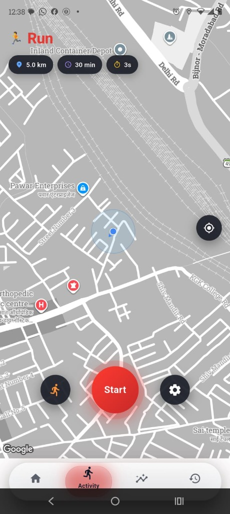
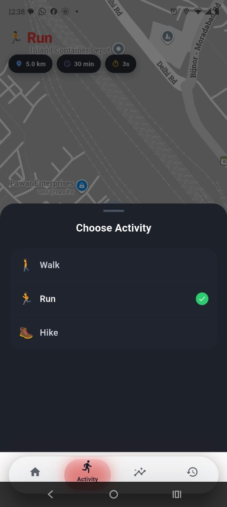
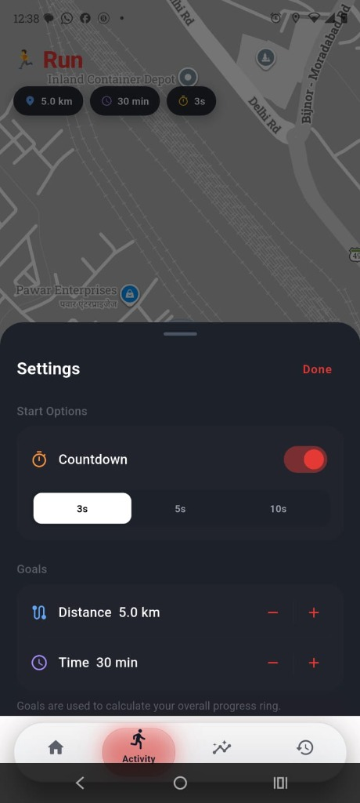
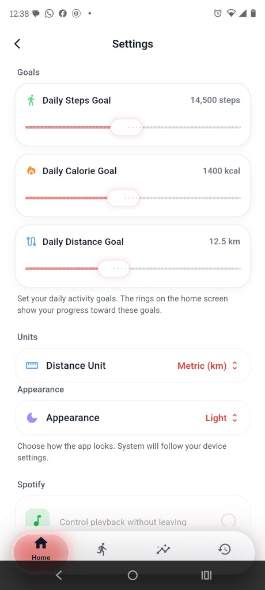

# Expedition

Premium offline-first fitness tracking for Flutter.

Expedition helps users track outdoor activities, analyze training trends, manage profile settings, and stay motivated through achievements, goals, and challenges — all without requiring an internet connection.

## Screenshots

| Live Activity Tracking | Choose Activity | Activity Settings | Goals & App Settings |
|:---:|:---:|:---:|:---:|
|  |  |  |  |

## Tech stack

- **Flutter** — cross-platform UI
- **Bloc** — predictable state management
- **GoRouter** — declarative navigation
- **Drift** — offline SQLite persistence
- **Dio** — HTTP client (future sync)
- **Google Maps** — live activity maps
- **Geolocator** — GPS tracking
- **fl_chart** — analytics charts
- **Material 3** — premium dark UI

## Features

- Onboarding with profile setup
- Home dashboard with streaks and weekly activity
- GPS activity tracking with route persistence
- Workout history with search, filter, and sort
- Analytics dashboard with charts and insights
- Profile and settings
- Gamification: achievements, goals, challenges, milestones
- Celebration animations on achievement unlock

## Architecture

Feature-first clean architecture:

```
lib/
├── app.dart                 # Bootstrap & dependency wiring
├── core/                    # Shared infrastructure
│   ├── constants/
│   ├── database/            # Drift tables & migrations
│   ├── errors/              # Centralized failure mapping
│   ├── navigation/
│   ├── router/
│   ├── services/            # Haptics, permissions, API
│   ├── theme/
│   └── widgets/             # Skeletons, empty states, errors
└── features/
    ├── activity/
    ├── analytics/
    ├── gamification/
    ├── history/
    ├── home/
    ├── onboarding/
    ├── profile/
    └── splash/
```

Each feature typically contains:

- `data/` — datasources & repositories
- `domain/` — models & business rules
- `presentation/` — blocs, screens, widgets

State flows **UI → Bloc → Repository → Drift**, with no direct database access from widgets.

## Installation

### Prerequisites

- Flutter SDK `^3.10.3`
- Xcode (iOS) / Android Studio (Android)
- Google Maps API keys configured for target platforms

### Setup

```bash
git clone <repository-url>
cd expedition
flutter pub get
dart run build_runner build --force-jit
flutter run
```

### Branding (before store release)

1. Add icon PNGs to `assets/branding/` (see folder README)
2. Run:

```bash
dart run flutter_native_splash:create
dart run flutter_launcher_icons
```

## Testing

```bash
flutter test
flutter analyze
```

Test coverage includes:

- Failure mapping
- History query engine
- Bloc loading/error states
- Route constants
- Validators

## Production quality highlights

- Skeleton loaders instead of spinners
- Premium empty states with CTAs
- Centralized error handling with retry/settings recovery
- Permission recovery flows for GPS
- Debounced history search with highlighted matches
- Haptic feedback for key interactions
- Accessibility semantics and 48dp touch targets
- Offline status banners
- Legal screens (Privacy Policy, Terms & Conditions, OSS licenses)

## Future roadmap

- Cloud sync and account backup
- Social challenges and leaderboards
- Apple Health / Google Fit integration
- Custom workout plans
- Wearable device support
- Localization (i18n)

## License

Proprietary — Expedition Team.
